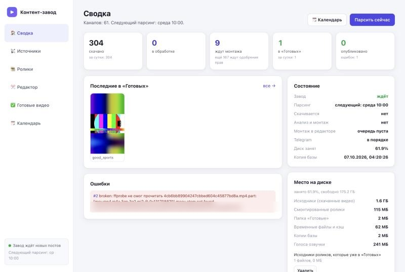
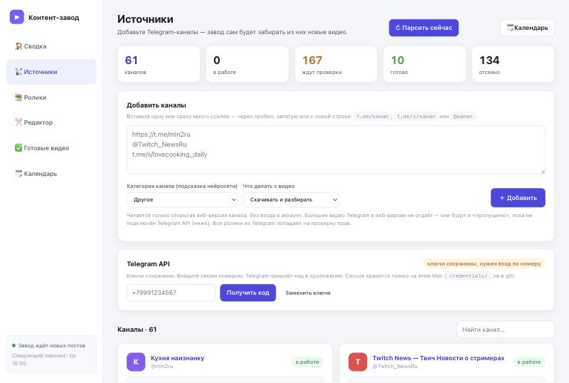
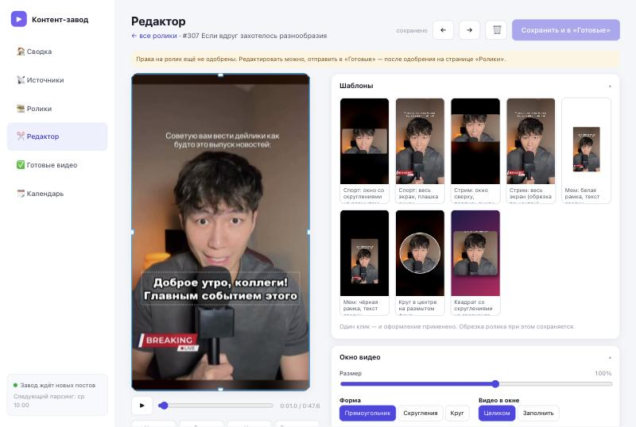

# Контент-завод

Локальная программа для вашего компьютера (Windows 10/11 или macOS). Она:

1. забирает видео из Telegram-каналов (и из своих папок);
2. распознаёт речь и оценивает ролики локальной нейросетью (Qwen 7B), без облака и платных ключей;
3. превращает их в вертикальные ролики 9:16 (1080×1920) в удобном редакторе: шаблоны, фоны, баннеры, субтитры, озвучка;
4. складывает результат в «Готовые» и, если нужно, публикует Reels в ваш Instagram через отдельное окно Chrome (вы сами входите в аккаунт, пароль программа не видит и не хранит).

Всё работает в браузере по адресу **http://127.0.0.1:8765**, но только на вашем компьютере: наружу сервер не открыт.

## Разделы

| Раздел | Что делает |
|---|---|
| **Сводка** | сколько скачано, ждёт монтажа, готово, опубликовано; ошибки; место на диске и кнопки очистки |
| **Источники** | Telegram-каналы: добавить ссылками или галочками из своего аккаунта, «Парсить сейчас», удалить канал |
| **Ролики** | все скачанные видео с категориями и оценками; «↻ Парсить», «🔵 Автозалив в кружке» |
| **Редактор** | превью вживую, шаблоны, перетаскивание окна видео, фон, баннер, субтитры (в том числе караоке), озвучка; пачкой — один шаблон на много роликов |
| **Готовые видео** | смонтированные ролики; скачивание в папку `Загрузки/Reels` как «reels 1.mp4», «reels 2.mp4»…; корзина |
| **Фоны** | библиотека картинок и видео для фона, отметки «использован» |
| **Instagram** | подключение аккаунта, переключение связанных аккаунтов, выбор роликов галочками, очередь, пауза, автопостинг |
| **Календарь** | в какие дни и часы парсить каналы |



---

## 1. Что нужно заранее (Windows)

- **Windows 10 (версия 1903 и новее) или Windows 11**, 64-бит.
- **Место на диске:** минимум **15 ГБ** свободно: программа и зависимости ~3 ГБ, модели ~5,5 ГБ, остальное под видео. Лучше SSD.
- **Память:** от 8 ГБ ОЗУ, рекомендуется 16 ГБ (нейросеть 7B на процессоре занимает около 5 ГБ).
- **Интернет** — для установки, скачивания моделей и видео.

Поставьте 4 программы. Проще всего через **winget** (он уже есть в Windows 10/11): нажмите `Win`, наберите «Терминал» или «PowerShell», откройте и выполните по очереди:

```powershell
winget install -e --id Python.Python.3.12
winget install -e --id Git.Git
winget install -e --id Gyan.FFmpeg
winget install -e --id Google.Chrome
```

Если ставите Python вручную с [python.org](https://www.python.org/downloads/windows/), нужна именно **3.12** (64-bit), и на первом экране установщика **обязательно отметьте галочку «Add python.exe to PATH»**.

После установки **закройте и заново откройте** окно терминала (иначе новые программы не будут видны) и проверьте:

```powershell
py -3.12 --version
git --version
ffmpeg -version
ffprobe -version
```

Каждая команда должна напечатать версию. Если `ffmpeg` «не является внутренней или внешней командой» — см. раздел «Частые проблемы».

---

## 2. Установка

### Шаг 1. Скачать завод

**Важно:** положите папку по пути **без русских букв и пробелов**, например `C:\content-zavod`. Некоторые библиотеки на Windows плохо работают с кириллицей в пути.

Через Git:

```powershell
cd C:\
git clone https://github.com/reter2017make-ship-it/content-zavod.git
cd content-zavod
```

Или без Git: на странице репозитория нажмите зелёную кнопку **Code → Download ZIP**, распакуйте архив в `C:\content-zavod`.

### Шаг 2. Запустить установку

Дважды щёлкните **`setup.bat`** в папке завода (или выполните `setup.bat` в терминале в этой папке). Скрипт:

1. найдёт Python 3.12 и проверит FFmpeg и Chrome;
2. создаст виртуальное окружение `.venv` (системный Python не трогается);
3. установит зависимости (5–15 минут);
4. поставит локальную нейросеть `llama-cpp-python` готовой сборкой для процессора (компилятор не нужен);
5. создаст ваши личные файлы настроек `.env` и `config\config.yaml` из примеров;
6. спросит, скачать ли модели сразу (ответьте `Y`, если интернет хороший).

Если Windows Defender SmartScreen покажет «Windows защитила ваш компьютер» — нажмите «Подробнее» → «Выполнить в любом случае» (это обычный текстовый скрипт, его можно открыть Блокнотом и прочитать).

### Шаг 3. Модели

Модели в репозиторий не входят (они большие). Их можно скачать на шаге установки или позже командой:

```powershell
.venv\Scripts\python -m app.cli download-models
```

| Модель | Размер | Куда | Зачем |
|---|---|---|---|
| Qwen2.5-7B-Instruct GGUF (Q4_K_M, 2 файла) | ~4,7 ГБ | кэш Hugging Face: `C:\Users\<вы>\.cache\huggingface` | категории, оценка «вирусности», описание |
| faster-whisper `small` | ~0,5 ГБ | там же | распознавание речи и субтитры |
| Голоса Piper (Ирина, Денис, Дмитрий, Руслан) | ~0,25 ГБ | `data\voices` | русская озвучка в редакторе |

Если не скачать заранее, модели скачаются сами при первом использовании (первый ролик будет обрабатываться долго).

**Что работает без моделей:** парсинг, скачивание, редактор, монтаж, «Готовые», публикация. Без нейросети категории и оценки ставятся простыми правилами; без whisper нет автосубтитров; без Piper нет озвучки.

Хотите положить модель вручную (например, скачали файлы `qwen2.5-7b-instruct-q4_k_m-00001-of-00002.gguf` и `...-00002-of-00002.gguf` с [huggingface.co/Qwen/Qwen2.5-7B-Instruct-GGUF](https://huggingface.co/Qwen/Qwen2.5-7B-Instruct-GGUF))? Положите оба файла в одну папку, например `C:\content-zavod\models\`, и в `config\config.yaml` в разделе `ai.llamacpp` добавьте строку `model_path: C:/content-zavod/models/qwen2.5-7b-instruct-q4_k_m-00001-of-00002.gguf` (косые черты `/`).

Голоса Piper вручную: файлы `ru_RU-irina-medium.onnx` и `ru_RU-irina-medium.onnx.json` (и так же для `denis`, `dmitri`, `ruslan`) с [huggingface.co/rhasspy/piper-voices](https://huggingface.co/rhasspy/piper-voices/tree/main/ru/ru_RU) положите в `data\voices\`.

---

## 3. Настройка

### `.env` — ключи (личное, никому не передавать)

Создаётся из `.env.example`. Для обычной работы **ничего заполнять не нужно**: ключи Telegram вводятся прямо в интерфейсе и сами записываются сюда. Остальные строки (Pexels, Pixabay, OpenAI и т. д.) нужны только для необязательных источников.

### `config\config.yaml` — настройки завода

Создаётся из `config\config.example.yaml` при установке или первом запуске. Открывайте Блокнотом. Самое полезное:

- `ai.provider: llamacpp` — локальная нейросеть. `rules` — без нейросети (быстро, слабее). `openai` — любой OpenAI-совместимый API (ключ `OPENAI_API_KEY` в `.env`).
- `ai.llamacpp.n_gpu_layers` — на Windows сборка работает на процессоре, значение можно не трогать.
- `web.port: 8765` — порт интерфейса.
- `ready.download_dir: ~/Downloads/Reels` — куда скачивать готовые ролики.
- `instagram_web` — окно часов, интервал и лимит публикаций (это же меняется на странице «Instagram»).
- `autofill` — сколько роликов на аккаунт берёт «Автозалив в кружке», размер кружка, баннер.

После правки `config.yaml` перезапустите завод.

---

## 4. Запуск

Дважды щёлкните **`start.bat`**. Откроется чёрное окно с сервером, а через несколько секунд — браузер на **http://127.0.0.1:8765**.

- **Не закрывайте чёрное окно**, пока работаете: пока оно открыто, завод работает и парсит по календарю.
- Остановить: в этом окне нажмите `Ctrl+C` (или просто закройте окно).
- Завод работает, только пока компьютер включён, не спит и в сети. Чтобы не засыпал: Параметры → Система → Питание → «Переводить в спящий режим» → «Никогда» (при питании от сети).
- Автозапуск при входе в Windows (по желанию): нажмите `Win+R`, введите `shell:startup`, Enter, и положите туда **ярлык** на `start.bat` (правой кнопкой по `start.bat` → «Создать ярлык», затем перенести ярлык).

Проверка окружения (что работает, чего не хватает):

```powershell
.venv\Scripts\python -m app.cli health
```

---

## 5. Подключение Telegram

Без входа завод читает **открытые** каналы через веб-версию `t.me/s/…` (только небольшие видео). Чтобы брать большие видео и каналы из своего аккаунта, войдите через официальный Telegram API:

1. Откройте [my.telegram.org](https://my.telegram.org), войдите своим номером → **API development tools** → создайте приложение (название любое) → получите **api_id** и **api_hash**. Это ваши личные ключи: у каждого человека свои, не берите чужие.
2. В заводе: **Источники → блок «Telegram API»** → вставьте api_id и api_hash.
3. Введите номер телефона (в формате `+7…`) → «Получить код» → введите код из приложения Telegram. Если включена двухэтапная проверка — ещё облачный пароль (он уходит только в Telegram).
4. Ниже появятся **«Мои каналы из Telegram»**: отметьте галочками, откуда брать видео.

Вход сохраняется в папке `credentials\` (файл сессии). **Никому не передавайте эту папку** — файл сессии даёт полный доступ к вашему Telegram. Она не попадает в git.



---

## 6. Подключение Instagram

1. Страница **Instagram** → «Подключить Instagram». Откроется **отдельное окно Google Chrome** со своим профилем (ваш обычный Chrome не трогается).
2. Войдите в Instagram **сами**, как обычно. Пароль программа не вводит, не видит и не хранит.
3. Вернитесь в завод и нажмите «Я вошёл». Появится ваш @ник.
4. Если в аккаунте есть связанные аккаунты — «↻ Обновить список», затем «Переключиться». Личный аккаунт можно «исключить», и завод никогда не будет на него переключаться и публиковать.

Вход хранится в папке `browser_profiles\` (не в git, никому не передавать). Если Instagram просит подтверждение, CAPTCHA или код — очередь **останавливается** и ждёт вас: пройдите проверку в окне Chrome и нажмите «Продолжить». Завод такие проверки не обходит.

Пока идёт публикация, не трогайте окно Chrome.

---

## 7. Как пользоваться

1. **Парсинг.** «Сводка» или «Ролики» → **«↻ Парсить»** (или «Парсить сейчас»). Новые видео скачиваются из каналов. Расписание — в «Календаре».
2. **Ролики.** Все скачанные видео с категорией, оценками и пометкой «есть текст в кадре» (на Mac). Отсюда любой ролик можно открыть в редакторе.
3. **Редактор.** Откройте ролик → клик по шаблону справа → при желании подвиньте окно видео и субтитры мышью, выберите фон из «Фонов», включите озвучку → **Enter** или «Сохранить и в «Готовые»». Сразу откроется следующий. Пачкой: отметьте несколько роликов в списке (Shift — диапазон), выберите шаблон → «Шаблон и в «Готовые»». Клавиши: Пробел — пуск/пауза, ← → — соседний ролик, Delete — в корзину.
4. **Готовые.** Смонтированные ролики. Отметьте → «Скачать выбранные»: файлы без пересжатия попадут в `Загрузки\Reels`.
5. **Автозалив в кружке** («Ролики» → «🔵 Автозалив в кружке»): отметьте аккаунты Instagram, каждому выберите фон и количество (по умолчанию 20), описание → «Предпросмотр» → «Запустить». Завод сам отберёт лучшие ролики (без текста, главное в центре, вирусность, свежесть, качество), смонтирует кружок с белой обводкой на фоне, добавит баннер снизу и поставит в очередь своего аккаунта. Ролики между аккаунтами не повторяются.
6. **Instagram.**
   - **Выбрать ролики для публикации:** отметьте ролики галочками (номер показывает порядок, Shift — диапазон), выберите аккаунт, при желании одно описание на все → **«📸 Опубликовать выбранные (N)»**.
   - «🚀 Опубликовать все из Готовых» — всё новое из «Готовых» в очередь.
   - **Очередь:** «Опубликовать сейчас», «✏️ Описание», «Пауза», «Повторить», «✕ Убрать»; кнопка «⏸ Пауза очереди» останавливает всё.
   - **Автопостинг:** галочка включает публикацию очереди по одному. Интервал (0 — подряд), окно часов и дневной лимит (0 — без лимита) — там же, «Сохранить».
   - Обложкой ставится фон, выбранный в редакторе.
7. **Место на диске** — внизу «Сводки»: удалить исходники готовых роликов, корзину, брак, временные файлы, опубликованное старше N дней.



---

## 8. Частые проблемы на Windows

| Проблема | Что делать |
|---|---|
| `ffmpeg не найден в PATH` / «ffmpeg не является командой» | `winget install -e --id Gyan.FFmpeg`, затем **закройте и откройте** терминал заново (или перезайдите в Windows). Проверка: `ffmpeg -version`. Вручную: скачайте сборку с [gyan.dev](https://www.gyan.dev/ffmpeg/builds/), распакуйте в `C:\ffmpeg` и добавьте `C:\ffmpeg\bin` в переменную PATH (Пуск → «Изменение системных переменных среды» → Переменные среды → Path → Создать). |
| `Не найден Python 3.12` | Поставьте Python 3.12 64-bit с галочкой «Add python.exe to PATH». Python 3.13 не подходит для части библиотек. |
| Ошибка при установке `llama-cpp-python` (CMake, «Microsoft Visual C++ 14.0 is required») | Значит, не нашлась готовая сборка. Завод всё равно работает (по правилам). Варианты: повторить `setup.bat` (бывают сбои сети); или в `config\config.yaml` поставить `ai.provider: rules`; или поставить [Build Tools for Visual Studio](https://visualstudio.microsoft.com/visual-cpp-build-tools/) с «Разработка классических приложений на C++» и выполнить `.venv\Scripts\pip install llama-cpp-python`. |
| Странные ошибки путей, `UnicodeDecodeError`, файлы не находятся | Папка завода лежит по пути с русскими буквами или пробелами. Перенесите в `C:\content-zavod` и снова запустите `setup.bat`. Запускайте только через `start.bat`: он включает UTF-8. |
| Антивирус удаляет или блокирует файлы, медленная установка | Добавьте папку `C:\content-zavod` в исключения Защитника Windows (Безопасность Windows → Защита от вирусов → Управление настройками → Исключения). При первом запуске разрешите Python доступ к сети, если спросит брандмауэр. |
| `address already in use` / порт 8765 занят | Завод уже запущен в другом окне — закройте его. Или поменяйте `web.port` в `config\config.yaml`. Кто занял порт: `netstat -ano | findstr 8765`. |
| `завод уже запущен другим процессом` | Открыто два окна `start.bat`. Оставьте одно. |
| Chrome не открывается для Instagram | Установите обычный Google Chrome (`winget install -e --id Google.Chrome`). Закройте окно Chrome завода, если оно зависло, и нажмите «Открыть Chrome». |
| Нет пометки «есть текст в кадре» | Распознавание текста в кадре работает только на macOS (встроенное Apple Vision). На Windows метка не ставится, остальное работает; «Автозалив» тогда просто не учитывает этот признак. |
| Нет голоса Milena в озвучке | Это голос macOS. На Windows доступны голоса Piper: Ирина, Денис, Дмитрий, Руслан. |
| Первый ролик обрабатывается очень долго | Скачиваются модели (~5 ГБ). Ход загрузки — в чёрном окне. Нейросеть на процессоре думает 20–60 секунд на ролик — это нормально. |

Логи — в папке `logs\` (`factory.log`, `logs\instagram\`). Если ролик в статусе «Ошибка», причину видно в интерфейсе.

---

## 9. Что не попадает в репозиторий и почему

Всё личное лежит только на вашем компьютере и закрыто в `.gitignore`:

| Что | Где | Почему |
|---|---|---|
| ключи API | `.env` | секреты |
| вход в Telegram | `credentials\` | файл сессии = полный доступ к аккаунту |
| вход в Instagram | `browser_profiles\` | профиль Chrome с cookies аккаунта |
| база данных и копии | `database\`, `data\backups` | ваши каналы, ролики, история публикаций |
| видео, фоны, баннеры, голоса, кэш | `data\`, `Готовые\` | большие файлы и чужой контент |
| модели | кэш Hugging Face, `models\` | гигабайты, скачиваются сами |
| логи и скриншоты ошибок | `logs\` | могут содержать ники и подписи |
| ваши настройки | `config\config.yaml` | в репозитории только пример `config.example.yaml` |
| виртуальное окружение | `.venv\` | ставится `setup.bat` |

Если делитесь заводом с кем-то — давайте ссылку на репозиторий или ZIP с GitHub, а не свою папку.

---

## 10. Риски автопостинга — прочитайте

- **Правила Instagram.** Публикация через браузер не является официальным API. Instagram может посчитать частые публикации подозрительными: попросить подтверждение, временно ограничить действия или заблокировать аккаунт. Начинайте с небольшого количества роликов в день и с пауз между ними, не публикуйте сотни роликов подряд, используйте для экспериментов не основной аккаунт. Ответственность за аккаунт — на вас.
- **Авторские права.** Ролики из чужих Telegram-каналов принадлежат их авторам. Перед публикацией убедитесь, что у вас есть право их использовать. Instagram удаляет ролики и аккаунты за нарушение авторских прав. Завод сохраняет у каждого ролика источник (канал, ссылку на пост), но **не проверяет права** — это решение и ответственность пользователя.
- Завод **не обходит** CAPTCHA, проверки входа и ограничения Instagram и Telegram, не вводит и не хранит пароли, не использует антидетект-браузеры и сторонние сервисы автопостинга. При любой проверке он останавливается и ждёт человека.

---

## Для macOS

```bash
brew install python@3.12 ffmpeg
cd ~/content-zavod        # папка с заводом
make setup                # .venv + зависимости (llama.cpp с Metal) + .env
make web                  # или: .venv/bin/python -m app.cli web
```

`make autostart` — автозапуск при входе в macOS (LaunchAgent, только Mac; при первом запуске macOS может спросить доступ к папке — «Разрешить»). `make autostart-off` — выключить. На Mac дополнительно работают пометка «есть текст в кадре» (Apple Vision) и голос Milena.

Если нужна пересборка нейросети с Metal: `CMAKE_ARGS="-DGGML_METAL=on" .venv/bin/pip install --no-cache-dir --force-reinstall --no-deps llama-cpp-python==0.3.8` (0.3.9+ падает на Metal в macOS 13).

## Docker (Windows, Mac, Linux)

Вариант без установки Python: Docker Desktop → в папке завода `docker compose up -d --build` → http://127.0.0.1:8765. Подробно: [docs/docker.md](docs/docker.md). Окно Chrome для Instagram в Docker не открывается — для публикации ставьте завод обычным способом.

## Командная строка

На Windows вместо `.venv/bin/python` пишите `.venv\Scripts\python`.

```bash
python -m app.cli health           # проверка окружения
python -m app.cli web              # веб-интерфейс + фоновый завод
python -m app.cli run --once       # один полный цикл без интерфейса
python -m app.cli run --dry-run    # что будет сделано, без изменений
python -m app.cli status           # статусы и последние ошибки
python -m app.cli download-models  # скачать модели
python -m app.cli cleanup          # очистить временные файлы
```

Тесты: `test.bat` на Windows или `make test` на Mac (около 180 тестов, несколько минут; сети и реальных аккаунтов не нужно).

## Как это устроено

```
источник → скачивание (temp → ffprobe → SHA-256 → data/raw) → дубли по хэшу и картинке
  → анализ: качество кадров → речь (faster-whisper) → нейросеть (llama.cpp, Qwen 7B) → оценки
  → редактор (живое превью = итоговый рендер FFmpeg) → «Готовые»
  → очередь Instagram (Playwright + отдельный профиль Chrome) → опубликовано, ID в базе
```

Код: `app/` (FastAPI-сервер `app/web`, редактор `app/editor`, источники `app/sources`, Instagram `app/instagram_web`, база SQLite через SQLAlchemy `app/database`), тесты `tests/`. Подробности разработки — [PROGRESS.md](PROGRESS.md), регламент — [CLAUDE.md](CLAUDE.md), набор каналов — [docs/channels.md](docs/channels.md).
